<picture>
  <source media="(prefers-color-scheme: dark)" srcset="assets/hero-dark.svg">
  
</picture>

 

I design and build backend systems, APIs and business-critical platforms: SaaS products, payment and financial integrations, and e-invoicing. I work across the whole backend lifecycle — architecture, database design, API development, integrations, performance and production troubleshooting — mostly in PHP and Laravel.

More than ten years of production work have left me with a clear preference: clean architecture, reliability and long-term maintainability over quick fixes. I'm happiest on systems where correctness, security and scale actually matter.

Currently **Senior Software Engineer at Tarat** (remote).

## Open source

Saudi Arabia's Phase 2 e-invoicing rules ask a lot of every single invoice: it has to be built as UBL XML, hashed, cryptographically signed, chained to the invoice before it, given a QR code, and then cleared or reported through ZATCA's API. Integrating that for the first time was a real challenge, so I turned what I learned into libraries anyone can use.

<picture>
  <source media="(prefers-color-scheme: dark)" srcset="assets/pipeline-dark.svg">
  
</picture>

<table>
  <tr>
    <td width="38%" valign="top">
      <a href="https://github.com/khaledhajsalem/zatca-php"><b>zatca-php</b></a> 
      
      
      
    </td>
    <td valign="top">
      The whole Phase 2 flow for <b>PHP</b>: XML generation, signing, QR codes, device onboarding, clearance and reporting. Its invoice scenarios are checked, one by one, against ZATCA's own sandbox validator.
    </td>
  </tr>
  <tr>
    <td valign="top">
      <a href="https://github.com/khaledhajsalem/zatca-node"><b>zatca-node</b></a> 
      
      
      
    </td>
    <td valign="top">
      The same flow for <b>Node.js</b>, written in TypeScript: invoice processing, signing and submission.
    </td>
  </tr>
  <tr>
    <td valign="top">
      <b>ZATCA Hub for Laravel</b> 
      
    </td>
    <td valign="top">
      A self-hosted management center built on zatca-php: companies and devices, guided onboarding with ZATCA, encrypted credentials, in English and Arabic.
    </td>
  </tr>
</table>

These libraries are unofficial and are not affiliated with or endorsed by ZATCA.

Smaller things: [langchain-pdf-assistant](https://github.com/khaledhajsalem/langchain-pdf-assistant), a PDF question-answering assistant in Python, and [jspdf-vue-cli-arabic-example](https://github.com/khaledhajsalem/jspdf-vue-cli-arabic-example), a working recipe for printing Arabic PDFs from Vue.

## What I work on

<table>
  <tr>
    <td width="33%" valign="top">
      <b>Architecture</b>  
      Backend and systems architecture 
      REST API design 
      Database design and optimization
    </td>
    <td width="33%" valign="top">
      <b>Integrations</b>  
      Payments and financial integrations 
      E-invoicing (ZATCA Phase 2) 
      Third-party services
    </td>
    <td width="33%" valign="top">
      <b>Production</b>  
      Performance optimization 
      Troubleshooting live systems 
      Linux servers
    </td>
  </tr>
</table>

  
  
  
  
  
  
  
  
  
  

## Path

<table>
  <tr><td><b>2024 — now</b></td><td>Senior Software Engineer · Tarat · remote</td></tr>
  <tr><td><b>2019 — 2025</b></td><td>Senior Software Engineer / Backend Engineer · iPhone Alsham · Gaza</td></tr>
  <tr><td><b>2018 — 2019</b></td><td>Full-stack Web Developer · FIS · Gaza</td></tr>
  <tr><td><b>2015 — 2019</b></td><td>Freelance Software Engineer, backend and APIs, for international clients</td></tr>
  <tr><td><b>Education</b></td><td>B.Sc. in Information Technology · Islamic University of Gaza</td></tr>
</table>

## Say hello

The QR code at the top is real: it opens the same profile.
